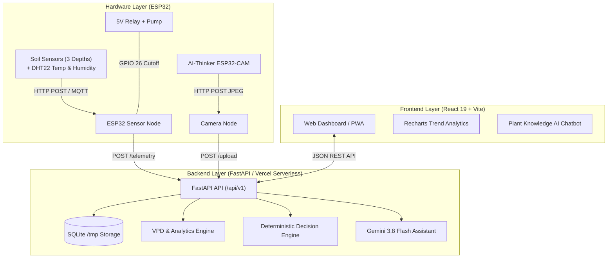

# Greetopia 🌱 — AI-Powered Smart Irrigation & Plant Care System

[](https://greetopia.vercel.app)
[](https://fastapi.tiangolo.com)
[](https://vitejs.dev)
[](https://ai.google.dev)
[](https://www.espressif.com)
[](https://pytest.org)

**Greetopia** is a full-stack, AI-grounded smart irrigation and plant telemetry platform. It connects physical ESP32 sensor and camera nodes to an interactive real-time dashboard powered by **FastAPI**, **React**, **SQLite**, and **Google Gemini AI**.

🌐 **Live Application:** [https://greetopia.vercel.app](https://greetopia.vercel.app)  
📖 **Hardware Setup Guide:** [`ESP32_SETUP_GUIDE.md`](ESP32_SETUP_GUIDE.md)

---

## 📑 Table of Contents

- [System Architecture](#system-architecture)
- [Key Features](#key-features)
- [Hardware & Pin Setup](#hardware--pin-setup)
- [Firmware Reference](#firmware-reference)
- [API Reference](#api-reference)
- [Local Quick Start](#local-quick-start)
- [Deployment on Vercel](#deployment-on-vercel)
- [Environment Variables](#environment-variables)
- [Safety & Fail-Safe Architecture](#safety--fail-safe-architecture)

---

## System Architecture



---

## Key Features

- **3-Depth Soil Telemetry:** Reads capacitive sensors at surface (~2–3cm), mid-depth (~7–8cm), and root zone (~15cm) to observe moisture infiltration dynamics.
- **Microclimate & VPD Engine:** Ingests DHT22 air temperature and humidity to compute live Vapor Pressure Deficit (VPD) in kPa with stress-band classification (*under-transpiration*, *healthy*, *high stress*).
- **Dual IoT Telemetry Ingestion:**
  - **Direct HTTP REST API (`POST /api/v1/plants/{id}/telemetry`):** Native HTTPS posting straight to Vercel without third-party broker dependencies.
  - **Authenticated MQTT Subscriber (`paho-mqtt`):** Full username/password and TLS support for persistent broker environments (e.g., HiveMQ, EMQX, Mosquitto).
- **Grounded Gemini AI Assistant (`gemini-3.8-flash`):** Conversational care assistant grounded in live sensor history, species care profiles, VPD, and recent watering events with automatic multi-model fallback.
- **Offline Plant Knowledge Base:** Bundled catalog of 36 curated plant profiles seeded into SQLite with fast full-text search.
- **Fail-Safe Hardware Protection:** 15-second hardcoded firmware safety cutoff, irrigation cooldown timers, and sensor freshness checks prevent overwatering.

---

## Hardware & Pin Setup

For a full step-by-step wiring guide, see [`ESP32_SETUP_GUIDE.md`](ESP32_SETUP_GUIDE.md).

| Component | Sensor Pin | ESP32 Pin | Purpose |
| :--- | :--- | :--- | :--- |
| **Surface Soil Sensor** | Analog Out | **GPIO 34** | Surface moisture (ADC1) |
| **Mid-Depth Soil Sensor** | Analog Out | **GPIO 35** | Mid root moisture (ADC1) |
| **Root-Zone Soil Sensor** | Analog Out | **GPIO 32** | Primary irrigation trigger (ADC1) |
| **DHT22** | Data Out | **GPIO 4** | Ambient temperature & relative humidity |
| **Relay Module** | Signal (IN) | **GPIO 26** | Submersible pump control (Active LOW) |
| **ESP32-CAM** | Camera Lens | Standalone Node | Periodic JPEG plant captures |

---

## Firmware Reference

Ready-to-flash Arduino sketches are located in [`firmware_reference/`](firmware_reference/):

- **[`sensor_node_greetopia_ready.ino`](firmware_reference/sensor_node_greetopia_ready.ino):** Production-ready sensor & pump node sketch. Supports both direct HTTP telemetry (Option A) and authenticated MQTT (Option B).
- **[`esp32_cam_greetopia_ready.ino`](firmware_reference/esp32_cam_greetopia_ready.ino):** AI-Thinker ESP32-CAM sketch with deep sleep, configurable upload token, and direct HTTP POST to `/upload`.
- **[`README.md`](firmware_reference/README.md):** Firmware protocol documentation.

---

## API Reference

The FastAPI backend exposes interactive OpenAPI docs at `/docs`.

### Core Endpoints

| Method | Endpoint | Description |
| :--- | :--- | :--- |
| `GET` | `/api/v1/health` | System health, Gemini configuration, and profile counts |
| `GET` | `/health/ready` | Readiness probe reporting database and MQTT status |
| `GET` | `/api/v1/plants` | List all tracked plants |
| `GET` | `/api/v1/plants/{id}/overview` | Complete plant snapshot: live readings, VPD, weather, analytics |
| `POST` | `/api/v1/plants/{id}/telemetry` | Ingest sensor readings directly via JSON HTTP POST |
| `POST` | `/api/v1/plants/{id}/water` | Trigger manual pump run (clamped 1–15s) |
| `POST` | `/api/v1/plants/{id}/decision` | Run deterministic irrigation check |
| `POST` | `/api/v1/plants/{id}/chat` | Ask Gemini about plant condition with grounded telemetry |
| `POST` | `/upload` | ESP32-CAM raw JPEG photo upload |
| `GET` | `/api/v1/plant-knowledge?q=tomato` | Search local offline-first plant database |

#### Example: Submitting Sensor Telemetry via HTTP

```http
POST /api/v1/plants/plant01/telemetry
Content-Type: application/json
X-Device-Token: your_optional_secret_token

{
  "soil_surface": 42.0,
  "soil_mid": 48.5,
  "soil_root": 35.0,
  "temperature_c": 25.1,
  "humidity_pct": 62.0
}
```

---

## Local Quick Start

### Prerequisites
- **Python 3.11+**
- **Node.js 20+** & npm

### 1. Backend Setup
```bash
cd backend
python -m venv .venv

# Windows:
.venv\Scripts\activate
# Linux/macOS:
source .venv/bin/activate

pip install -r requirements.txt
uvicorn app.main:app --reload --host 0.0.0.0 --port 5000
```

### 2. Frontend Setup
In a second terminal:
```bash
cd frontend
npm install
npm run dev
```
Open [http://localhost:5173](http://localhost:5173). The Vite dev server automatically proxies `/api` calls to `http://localhost:5000`.

---

## Deployment on Vercel

Greetopia is pre-configured for seamless single-repository deployment on **Vercel** using multi-service routing:

- **`vercel.json`** routes:
  - `/api/(.*)`, `/upload`, `/health/(.*)`, `/docs` → `backend` (FastAPI serverless function)
  - `/(.*)` → `frontend` (Vite single-page application)
- **Automatic Serverless Detection:** Backend automatically detects Vercel environments and switches the SQLite database and photo directory to `/tmp` with runtime writability fallback.

---

## Environment Variables

Copy `backend/.env.example` to `backend/.env` for local configuration:

```env
# Application
APP_NAME=Greetopia API
API_PREFIX=/api/v1
CORS_ORIGINS=http://localhost:5173,http://localhost,*

# MQTT Broker (Optional for Persistent Container Hosting)
MQTT_ENABLED=false
MQTT_HOST=127.0.0.1
MQTT_PORT=1883
MQTT_USERNAME=
MQTT_PASSWORD=
MQTT_TLS=false

# Google Gemini AI
GEMINI_ENABLED=true
GEMINI_MODEL=gemini-3.8-flash
GEMINI_API_KEY=your_gemini_api_key_here
GEMINI_CHAT_API_KEY=

# Safety & Irrigation Engine
AUTO_DECISIONS_ENABLED=false
DECISION_INTERVAL_MINUTES=15
IRRIGATION_COOLDOWN_MINUTES=30
ROOT_MOISTURE_THRESHOLD=28
DEFAULT_WATER_SECONDS=5

# Optional Security Tokens
DEVICE_UPLOAD_TOKEN=
```

---

## Safety & Fail-Safe Architecture

Greetopia enforces multi-layer safety controls to prevent accidental overwatering:

1. **Hardware Cutoff:** Firmware code clamps maximum pump activation to **15 seconds**, turning the relay OFF even if network or server communication drops.
2. **API Clamping:** Manual water requests are strictly validated to `1..15` seconds by Pydantic schemas.
3. **Irrigation Cooldown:** A 30-minute mandatory cooldown window prevents repeated watering cycles before water has soaked to the root zone.
4. **Sensor Freshness Safeguard:** The automatic decision engine refuses to trigger pump commands if telemetry readings are older than 5 minutes.
5. **Rain Skip Logic:** Integrated weather forecasts skip scheduled irrigations if rain probability exceeds the configured threshold.

---

## Automated Test Suite

Run backend test verification (includes API routes, VPD, decision engine, and telemetry ingestion):

```bash
cd backend
python -m pytest tests/ -v
```
*(All 10 unit and integration tests passing).*

---

## License

This project is open-source under the MIT License.
